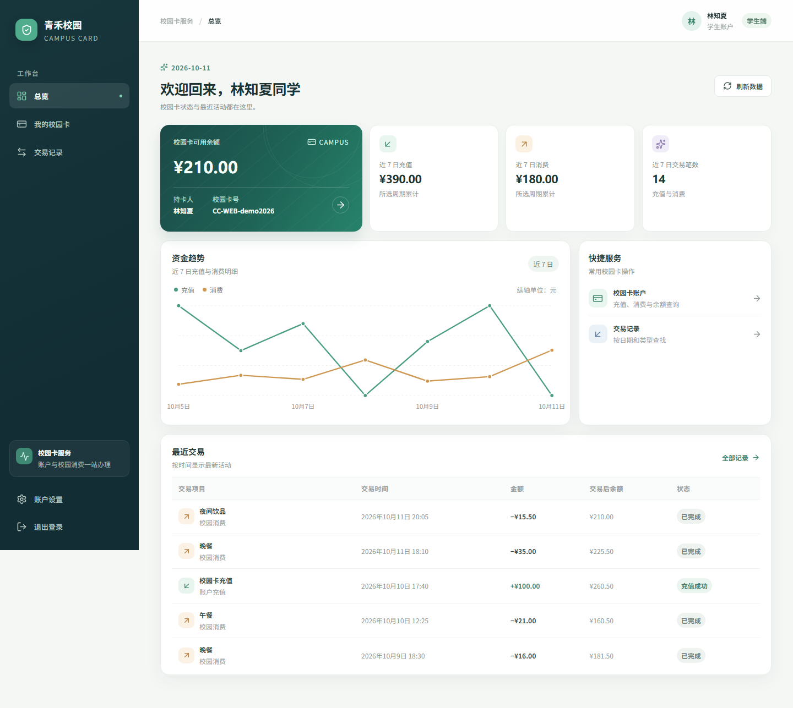

# 青禾校园卡管理系统

Vue 3 + TypeScript + Spring Boot 4 的中文网页系统，MySQL 保存用户、校园卡和交易流水。学生可查看余额、模拟充值消费、查询和导出交易；管理员可开户、编辑用户、启停账户并查看统计。



## 启动

需要 Java 17+、Maven 3.9+、Node.js 24 LTS 和 MySQL 8.0。

```powershell
# 初始化本地数据库和示例账户；-WebDemo 可选，用于体验真实示例流水
powershell -ExecutionPolicy Bypass -File scripts/init-db.ps1 -Seed -WebDemo
# 复制 config/application.example.properties 为 config/application.properties 并填写数据库连接
powershell -ExecutionPolicy Bypass -File scripts/build.ps1 -UseMirror
powershell -ExecutionPolicy Bypass -File scripts/start.ps1 -Background
```

浏览器打开 http://127.0.0.1:8088 。停止服务使用 `scripts/stop.ps1`，Windows 重新构建前先停止已运行的服务以释放 JAR。不加 `-Background` 则在终端运行。端口可用 `-Port` 指定，默认仅监听本机。

数据库账号有密码时初始化加 `-PromptPassword`，支持 `-HostName/-Port/-User/-Database`。真实数据库配置不提交 Git。环境变量 `CC_DB_URL/CC_DB_USER/CC_DB_PASSWORD` 优先于外置配置，配置文件路径可通过 `-Dcampus.config=绝对路径` 指定。运行账号仅需 SELECT/INSERT/UPDATE，初始化使用具有建表权限的独立账号。

示例：`admin / admin123`、`student / student123`；导入 `-WebDemo` 后可用 `demo2026 / student123` 体验七天交易趋势。示例余额通过真实充值消费流水形成，脚本重复导入不重复记账。此系统模拟资金操作，不接入真实支付。

## 构建与开发

网页资源打包到 `server/target/campus-card-web.jar`，无需独立部署前端。跨平台从项目根目录执行：

```sh
npm --prefix web ci
npm --prefix web run build
mvn -B -ntp package
java -Dfile.encoding=UTF-8 -jar server/target/campus-card-web.jar
```

Maven Central 不可用时加 `-s config/maven-settings-mirror.xml`。开发时后端运行于 8088，`npm --prefix web run dev` 启动 5178 的前端，Vite 代理 `/api`。前后端同源使用 HttpOnly Session Cookie 和 CSRF，不在浏览器存储登录令牌。

## 工程

| 目录 | 职责 |
| --- | --- |
| common | 实体、业务接口和公共 DTO |
| backend | 业务、PBKDF2 密码处理、JDBC DAO 与事务 |
| server | Spring Boot REST、Spring Security、HikariCP 和网页资源 |
| web | Vue 3、TypeScript、Pinia、Vue Router、Vite、Lucide 图标与自定义样式 |
| database | 建表、种子和可选网页演示数据 |
| frontend | 保留的 Swing 桌面版 |

初版保留于 `v1.0.0-swing` 标签。当前构建也生成 `frontend/target/campus-card-system.jar`，可用 `scripts/start-desktop.ps1` 运行。

金额采用 BigDecimal 与 DECIMAL(12,2)，API 使用十进制字符串；必须为正数且最多两位小数。余额更新与流水插入在同一事务中完成，按用户→卡片顺序加锁；唯一操作编号防止重复提交。网络故障时界面保留原请求，先查询结果再用同一编号重试。管理员不能直接修改余额；停用保留卡片和历史。日期按上海时区解释，结束日期包含当天。

## 后台测试

测试使用单独的 `campus_card_test` 或其他以 `_test` 结尾的数据库，绝不能使用运行库。先初始化测试库并提供测试账号建表和清理权限。未配置测试库时数据库测试跳过；配置后连接失败会使测试失败。

```powershell
$env:CC_TEST_DB_URL='jdbc:mysql://127.0.0.1:3306/campus_card_test?connectionTimeZone=Asia/Shanghai&allowPublicKeyRetrieval=true'
$env:CC_TEST_DB_USER='test-user'
$env:CC_TEST_DB_PASSWORD='test-password'
$env:CC_DB_URL=$env:CC_TEST_DB_URL
$env:CC_DB_USER=$env:CC_TEST_DB_USER
$env:CC_DB_PASSWORD=$env:CC_TEST_DB_PASSWORD
npm --prefix web ci
npm --prefix web test
npm --prefix web run build
mvn -B -ntp verify
```

本机可加载已忽略的 `local/test-env.ps1` 设置测试参数。Linux 通过 `xvfb-run -a mvn verify` 验证保留的 Swing 测试。网页 E2E 使用 Playwright 的 headless Chromium，不依赖 computer use；首次运行需在 `web` 目录执行 `npx playwright install chromium` 安装测试浏览器；先用初始化脚本为测试库导入 `-Seed -WebDemo`，保持上述 CC_DB_*=CC_TEST_*，设置 `$env:CC_E2E_URL="http://127.0.0.1:8089"`，执行 `npm --prefix web run test:e2e`。测试框架自动启动和关闭独立的 8089 服务（该端口需空闲），并拒绝正常运行库与其他网址。GitHub Actions 在独立 MySQL 服务上验证并上传网页 JAR。

分工边界和接口约定见 `WEB_CONTRACTS.md`；原桌面契约见 `CONTRACTS.md`。四个编码子智能体分别负责持久化、后端、网页前端和测试，统筹负责公共接口、装配、审查和发布。
